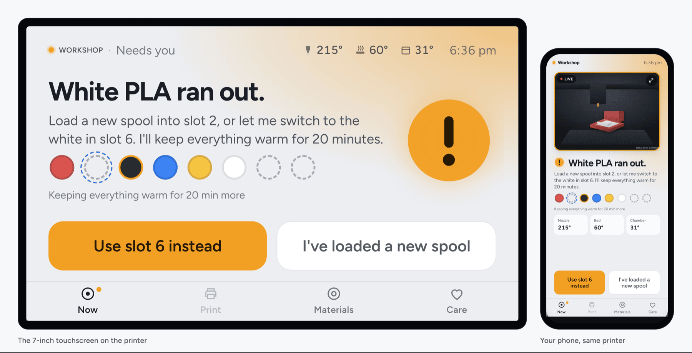
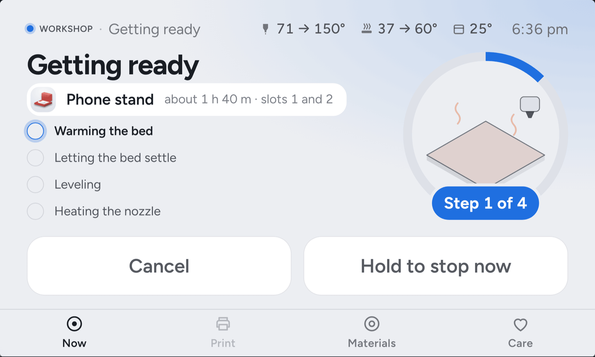
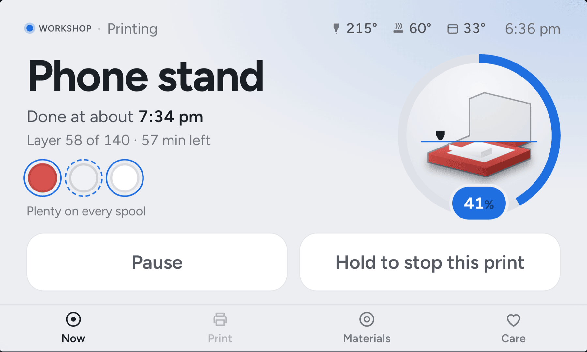
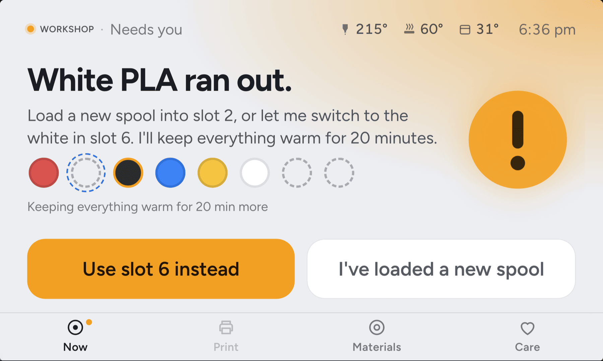
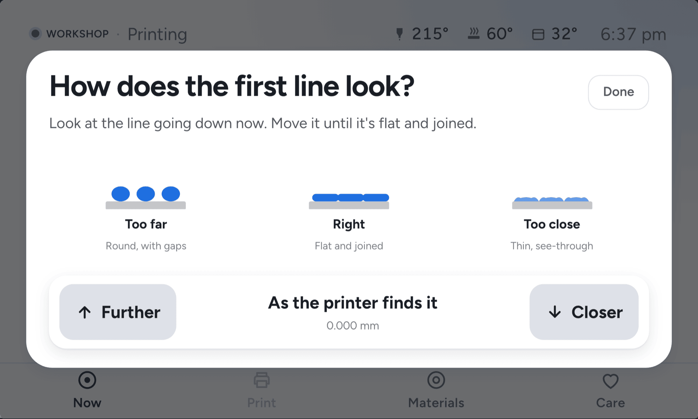
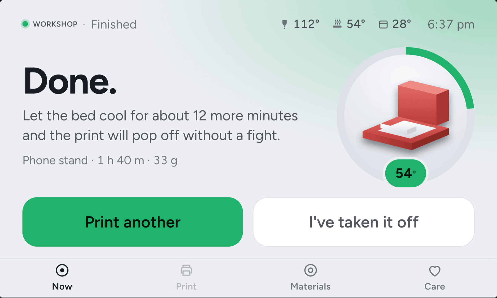
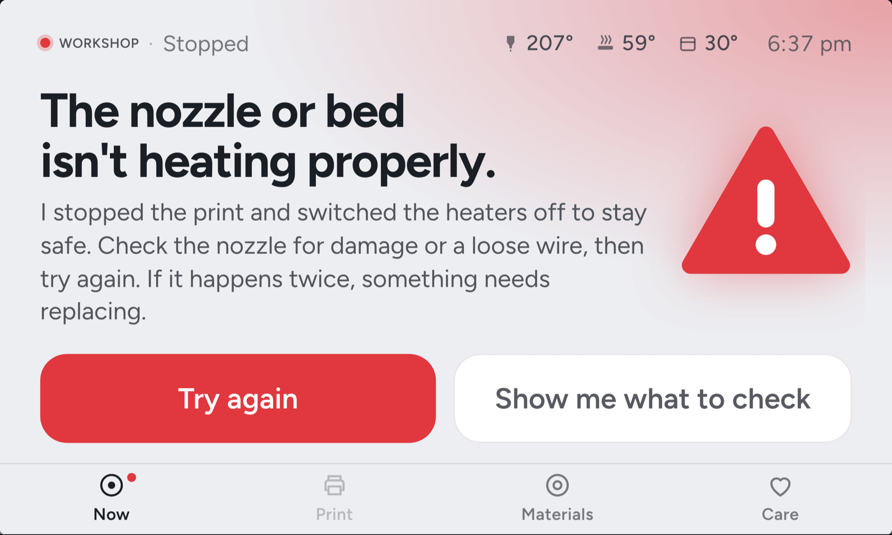
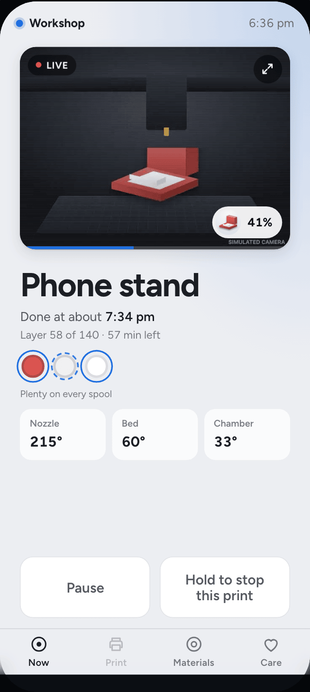
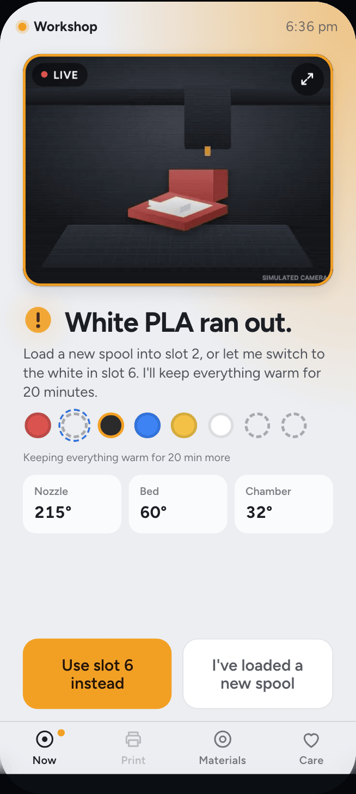
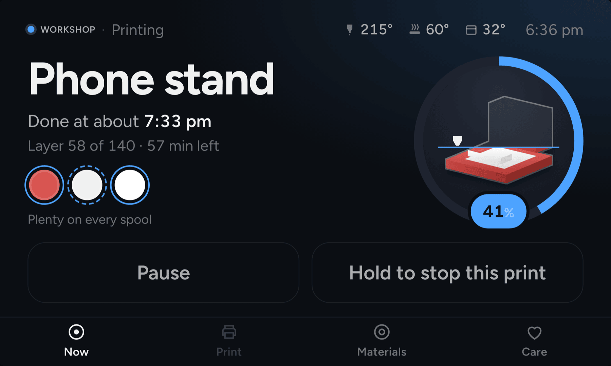

<h1 align="center">Elyir Bench</h1>

<p align="center"><b>A Klipper 3D printer that tells you what it needs, in one sentence.</b></p>

<p align="center">
  <a href="https://bench.elyir.com/try"></a>
  <a href="LICENSE"></a>
</p>

<p align="center">
  <a href="https://bench.elyir.com/try"><picture><source media="(prefers-color-scheme: dark)" srcset="docs/images/hero.png"></picture></a>
</p>

<p align="center"><b><a href="https://bench.elyir.com/try">Try the live demo</a></b>: the real screens and a pretend printer, running in your
browser. Make the filament run out, start a print, break a heater. No printer, no install.</p>

Elyir Bench is a calm, consumer-grade touchscreen and phone interface for 3D printers that run
[Klipper](https://www.klipper3d.org/) and [Moonraker](https://moonraker.readthedocs.io/).
Instead of heaters, macros and tool numbers, it shows one thing: what the printer is doing and what,
if anything, it needs from you. One primary action per state; everything else stays one long-press
away behind an **Advanced** door that opens Mainsail.

## What it looks like

<table>
  <tr>
    <td width="50%"><picture><source media="(prefers-color-scheme: dark)" srcset="docs/images/panel-getting-ready.png"></picture><br>
      <b>Getting ready.</b> The warm-up, step by step, in plain words.</td>
    <td width="50%"><picture><source media="(prefers-color-scheme: dark)" srcset="docs/images/panel-printing.png"></picture><br>
      <b>Printing.</b> When it will be done, and which spools it's using. A multi-colour print swaps by itself.</td>
  </tr>
  <tr>
    <td><picture><source media="(prefers-color-scheme: dark)" srcset="docs/images/panel-runout.png"></picture><br>
      <b>Needs you.</b> What happened, in one sentence, and the two things you can do about it.</td>
    <td><picture><source media="(prefers-color-scheme: dark)" srcset="docs/images/panel-first-layer.png"></picture><br>
      <b>The first layer.</b> Too far, right or too close: nudge it while it prints, and it's kept for next time.</td>
  </tr>
  <tr>
    <td><picture><source media="(prefers-color-scheme: dark)" srcset="docs/images/panel-finished.png"></picture><br>
      <b>Done.</b> How long until the part lifts off, and what to print next.</td>
    <td><picture><source media="(prefers-color-scheme: dark)" srcset="docs/images/panel-problem.png"></picture><br>
      <b>When something's wrong.</b> What happened and what to check, instead of a Klipper error.</td>
  </tr>
</table>

<p align="center">
  <picture><source media="(prefers-color-scheme: dark)" srcset="docs/images/phone-printing.png"></picture>
  &nbsp;&nbsp;
  <picture><source media="(prefers-color-scheme: dark)" srcset="docs/images/phone-runout.png"></picture>
  <br><b>Your phone, the same printer.</b> The camera, the status and the same buttons as the touchscreen.
</p>

<table>
  <tr>
    <td width="50%"></td>
    <td width="50%"></td>
  </tr>
  <tr><td colspan="2" align="center"><b>Light or dark.</b> The touchscreen keeps the one you pick; each phone has its own setting, or follows the phone.</td></tr>
</table>

**Status: early.** It runs every day on a handful of Klipper printers (Raspberry Pi class boards,
a 7" DSI panel or an HDMI touchscreen, some with Anycubic ACE Pro filament units). Expect rough
edges, missing hardware support and interfaces that change.

## Filament units, built in

Elyir Bench has its own driver for the Anycubic ACE Pro, free and open source (AGPL-3.0-only) like the rest, and it
works with units that Happy Hare or AFC already run. Nothing extra to install, no Klipper add-on.

| Unit | How Elyir Bench drives it | Today |
|---|---|---|
| Anycubic ACE Pro | Its own driver, `units/` | Tested on a real printer: loads, swaps, two-color prints |
| Happy Hare units: ERCF, Tradrack and others | Happy Hare's own commands | **New:** tried in the simulator, not yet on a real unit. [Testers wanted](https://bench.elyir.com/testers) |
| AFC units: Box Turtle, Night Owl and others | AFC's own commands | **New:** tried in the simulator, not yet on a real unit. [Testers wanted](https://bench.elyir.com/testers) |

- **Load and unload from the screen**, with the spool's color and material kept per slot.
- **Multi-color prints switch spools by themselves**, and the print carries on where it stopped.
- **Drying and feed assist** on an ACE Pro; **check and measure** a Happy Hare or AFC unit from the screen.

An ACE Pro that nothing drives yet just works once Elyir Bench is installed. A unit already set up another way stays as
it is: Elyir Bench never puts its own driver beside Happy Hare or AFC, and a printer on KlipperACE is asked once before
switching (one setting switches back). The ACE Pro driver was written from scratch from USB captures of a real unit
([`units/ace-protocol.md`](units/ace-protocol.md); every fact names its capture), with no code from another ACE
project. More: [docs/filament-units.md](docs/filament-units.md).

## The parts

| Part | Where | What |
|---|---|---|
| Intent layer | `printer/` | A Moonraker component that publishes one human-readable object: state, headline, actions. All printer logic lives here. |
| Simulator | `simulator/` | A pretend Moonraker that runs the real intent layer over scripted scenarios, so the UI can be built on a laptop. |
| App | `app/` | The Vue app. Runs full screen on the printer's panel and in a phone's browser. Renders the intent object and contains no printer logic. |
| Slicer | `slicer/` | A model, a purpose and a spool in; G-code and every setting it changed out. Wraps OrcaSlicer's command line. See [docs/slicer.md](docs/slicer.md). |
| Installer | `installer/`, `kiosk/` | Runs on the printer: detects the hardware, installs Elyir Bench, keeps it correct, rolls back a bad release. See [docs/installer.md](docs/installer.md). |
| Door | `door/` | Phone pairing, HTTPS on the printer's own name, reaching it from away, Web Push. See [docs/door.md](docs/door.md). |
| Filament units | `units/`, `printer/filament_units.py` | Its own driver for the Anycubic ACE Pro, a small service that talks to the unit over USB and to Klipper through Moonraker; Happy Hare and AFC units through their own commands. See [docs/filament-units.md](docs/filament-units.md). |

Where it is heading: [docs/vision.md](docs/vision.md).

## Run it on your Mac (or any laptop)

Needs Python 3.10+ with `aiohttp`, and Node.js 20+.

```bash
python3 -m venv ~/.venvs/elyir-bench && ~/.venvs/elyir-bench/bin/pip install aiohttp pytest pytest-asyncio pywebpush

# terminal 1: the pretend printer (4x speed, starts a full day)
cd simulator && ~/.venvs/elyir-bench/bin/python sim.py
#   control page with scenario buttons: http://localhost:7126/sim

# terminal 2: the app, pointed at the simulator
cd app && npm ci && npm run dev:sim
#   panel view:  http://localhost:3000        (resize to 800x480 to see the panel layout)
#   phone view:  the same URL, narrower, or ?screen=phone
```

Scenarios: `day`, `idle`, `print`, `runout`, `problem`, `finished`, `offline`. Pick one with
`sim.py --scenario runout` or tap it on the control page. `sim.py --no-ace` is a printer with a
single spool, `--no-camera` one without a camera.

Point the app at a real printer without rebuilding: `http://localhost:3000/?printer=<printer>.local:7125`.

## Build the browser demo yourself

```bash
cd app && npm ci && npm run build:demo
python3 -m http.server -d dist-demo 8000     # any static host works
```

`dist-demo/` is static files: the app on a 7" panel and a phone side by side, both talking to
the simulator and the real intent layer running in the page through
[Pyodide](https://pyodide.org/). Buttons beside them cause runouts, faults and finished prints.

## Install

On a Raspberry Pi printer that already runs Klipper and Moonraker, over SSH:

```bash
curl -fsSL https://bench.elyir.com/install | sh
```

It checks the printer first, says what it will do, and asks once before it changes anything (never during a
print). Then it shows a QR code: your phone opens the printer, ready to go. Every release is signed and checked
before it is unpacked. More, with the table of boards: [bench.elyir.com/install](https://bench.elyir.com/install).

- **It adds** Elyir Bench at `http://<printer>.local:8088/`, on the printer's touchscreen if you say so, and a
  name on Elyir's relay (`<printer>.elyir.app`) for notifications and your phone away from home.
- **An ACE Pro** gets Elyir Bench's own driver, with one include line in printer.cfg; a printer on KlipperACE is
  asked first, and a unit on Happy Hare or AFC stays theirs ([docs/filament-units.md](docs/filament-units.md)).
- **It leaves alone** printer.cfg (apart from that line) and your macros, Mainsail or Fluidd (still on port 80), your files and print
  history. KlipperScreen stays installed.
- **Will it work on my printer?** A Raspberry Pi 4 or 5 on Debian 13 gets everything. On Debian 11 or 12, or a
  BTT Pi or CB1, everything works except slicing on the printer itself (another printer running Elyir Bench on
  your Wi-Fi slices for it), and a BTT board's screen has simpler animations. A Raspberry Pi 3, other boards
  and 32-bit systems: not yet; the command checks and changes nothing. The same list is in
  `expectations()` in `installer/elyir_bench.py`, which the command and the page both use.
- **Updating:** run the same command again.
- **Taking it off:** `elyir-bench remove` on the printer. The screen goes back to KlipperScreen;
  `~/printer_data/config/elyir-bench.conf` stays, in case you come back.

## From a checkout

To try your own changes on a printer, with SSH access to it with a key. From your laptop:

```bash
./deploy.sh <printer>.local plan     # what would change; nothing is touched
./deploy.sh <printer>.local          # build a release, copy it, run `elyir-bench apply` there
./deploy.sh <printer>.local doctor   # check everything without changing anything
```

`SSH_USER=<user>` if the printer's user isn't `pi`. On the printer itself:

```bash
elyir-bench doctor                     # ~/.local/bin/elyir-bench
elyir-bench panel klipperscreen        # give the screen back to KlipperScreen (or: elyir-bench)
elyir-bench rollback                   # the previous release
elyir-bench check                      # what the install command says first
```

Settings live in `~/printer_data/config/elyir-bench.conf`. A release that fails its health check is rolled back
automatically. `remote: own` uses your own relay instead of Elyir's (see [docs/door.md](docs/door.md));
`remote: off` keeps the printer to your Wi-Fi, where everything works without one.

## The intent object

```jsonc
{
  "state": "needs_you",            // ready | preparing | printing | needs_you | finished | problem
  "phase": "runout",               // finer detail for the UI, never shown as text
  "headline": "White PLA ran out.",
  "detail": "Load a new spool into slot 2, or let me switch to the white in slot 6.",
  "actions": [ { "id": "swap_slot", "label": "Use slot 6 instead", "primary": true, "args": { "slot": 5 } },
               { "id": "loaded", "label": "I've loaded a new spool" } ],
  "job": { "name": "Phone stand", "progress": 0.4, "eta_clock": "4:10 pm", "layer": 56, "layers": 140 },
  "spools": [ { "slot": 0, "color": "#D9534F", "material": "PLA", "grams": 610, "status": "ready" } ],
  "printer": { "name": "Workshop", "connected": true, "advanced_url": "http://workshop.local/" },
  "raw": "Spool is empty"          // the underlying Klipper text, for Advanced
}
```

On Moonraker: `GET /printer/intent`, `POST /printer/intent/action {action, args}`, and the
websocket notification `notify_intent_update`. Phone-worthy moments (needs you, stopped, done,
ready to lift off) are published as `notify_elyir-bench_event`; the door is the only thing that sends
them to phones.

## Tests

```bash
for d in printer door installer slicer units; do (cd $d && ~/.venvs/elyir-bench/bin/python -m pytest -q tests); done
cd app && npm test && npm run build
```

## Principles the code follows

- Every sentence a person reads lives in the intent layer, nowhere else.
- One primary action per state. A second is allowed. A third is a bug.
- Subsystem names (macros, tool numbers, heater names) never reach the UI.
- Advanced is a door to Mainsail, opened by holding the printer's name for two seconds.

## License

Elyir Bench is free software under the GNU Affero General Public License, version 3 only (`AGPL-3.0-only`): see [LICENSE](LICENSE).
If you run a modified copy as a service for other people, they get your changes too.
Contributions are accepted under a contributor license agreement, see
[CONTRIBUTING.md](CONTRIBUTING.md). Third-party parts: [NOTICE](NOTICE).
